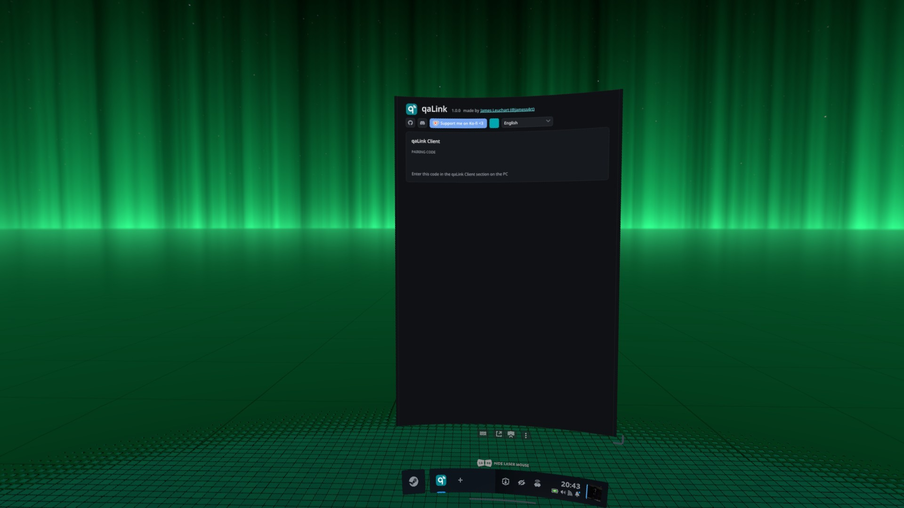
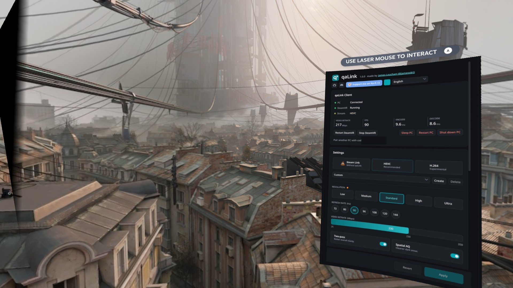
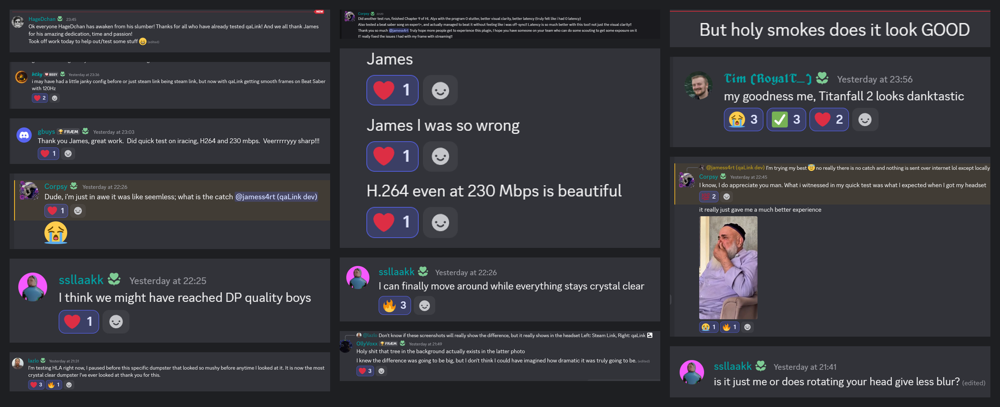

# qaLink    [](https://discord.gg/Jf5VzNHTuc)

Hello to all my fellow Framelings! 😎

qaLink (pronounced "kayLink") is a plug-and-play tool that makes Steam Link VR a lot more stable and better looking. It exposes hidden *(and new)* settings, lets you switch the codec to H.264 and does a few other things

My goal is that you don't have to tinker much: good defaults, no cargo culting, fewer issues. And BYE to Virtual Desktop!

For context: I'm an AV1 contributor and one of the admins in the main AV1 community server


 
#
### Early reactions to qaLink 1.0.0
<p align="center"></p>

#

<p align="center"></p>
<p align="center"></p>
<p align="center"><em>Steam Frame screenshot (compressed). The difference is even bigger in the headset</em></p>

## Requirements
- Windows (Linux support planned after release)
- SteamVR 2.18 or beta 2.19.3 -> **I RECOMMEND BETA !! Both SteamOS & SteamVR**
- An NVIDIA GPU (AMD support is experimental, but should work! Thx @ssllaakk for testing)
- A Steam Frame (other headsets, such as a Quest, get HEVC only for now. It has not been tested a lot yet)
- qaLink Client: SteamOS beta 0.5.6, 0.5.7, 0.5.8, 0.5.9 or 0.6.0, in developer mode, with a password for your user

## Install
PC:
1. Download `qaLink-x.y.z.zip` from [Releases](https://github.com/jamess4rt/qaLink/releases/latest) and unzip it to
   a folder it can stay in, such as `C:\qaLink`.
2. Run `qalink.exe` and click **Install** in the Overview section. Restart SteamVR if it is running.
3. Connect with your headset to Steam Link and enjoy! Adjust settings like you want
#
Steam Frame: open Konsole and run (you can copy that from Chrominium on your Frame)
```
curl -fsSL https://github.com/jamess4rt/qaLink/releases/latest/download/client.sh | bash
```

Type the pairing code it prints into the **qaLink Client** section on the PC and click **Pair**

Make sure to use the same qaLink version on the PC and the Frame

## Uninstall
- PC: click **Uninstall** in the Overview section, then delete the folder
- Frame: `sudo /etc/qalink-client/qalink-client uninstall`

## License
[PolyForm Strict 1.0.0](LICENSE.md): free for noncommercial use; no changes or redistribution.

For commercial use, contact me.

Third-party license notices: `THIRD_PARTY_NOTICES.txt` in the zip. Provided as is, without warranty.

qaLink is not affiliated with Valve, NVIDIA or AMD. Steam, SteamVR, Steam Link and Steam Frame are trademarks of
Valve Corporation; NVIDIA and NVENC of NVIDIA Corporation; AMD of Advanced Micro Devices, Inc.

## Was AI used in this project?

Yes, as a tool. I used it mainly for reverse engineering, research, data gathering, legal stuff, reviewing code, and a loooooot of unattended testing over night (even had burn-in on my Frame for a moment!!). It also helped me debug problems and automate parts of my workflow

The AMF (AMD) part is the exception: I don't have an AMD GPU, so it's fully vibe coded, from my AMF experience without testing on real hardware. Some users already reported that it works well! :)

All of this took ~260 hours of active work (tracked with ProcrastiTracker) in 2.5 weeks. I almost burned out, so I'm resting for a bit, but the next update and fixes are coming soon ♥
