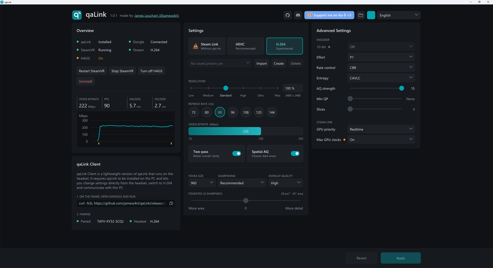
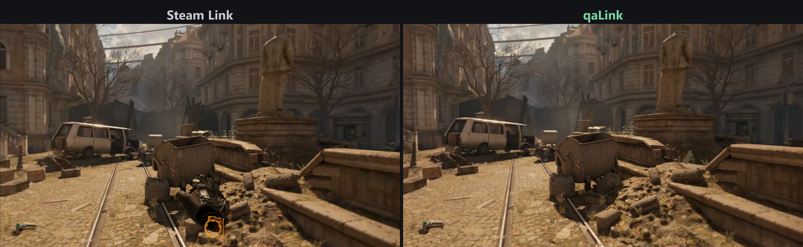
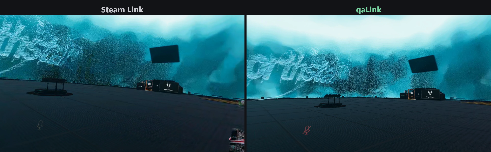

> [!IMPORTANT]
> ## qaLink 1.1.0 is coming soon™!!
> **Ready for SteamOS 0.5.10 and SteamVR 2.19.4 (beta)**

> [!WARNING]
> ## 1.0.0 isn't compatible with current latest betas ! Please wait for 1.1.0, it's currently being play tested by my contributors


# qaLink    [](https://discord.gg/Jf5VzNHTuc)

Hello to all my fellow Framelings! 😎

qaLink (pronounced "kayLink") is a plug-and-play tool that makes Steam Link VR a lot more stable and better looking. It exposes hidden *(and new)* settings, lets you switch the codec to H.264 and does a few other things

My goal is that you don't have to tinker much: good defaults, no cargo culting, fewer issues. And BYE to Virtual Desktop!

For context: I'm an AV1 contributor and one of the admins in the main AV1 community server



 
#
### Early reactions to qaLink 1.0.0
<p align="center"></p>

#

<p align="center"></p>
<p align="center"></p>
<p align="center"><em>Steam Frame screenshot (compressed). The difference is even bigger in the headset</em></p>

## Requirements (1.0.0)
- Windows 10/11 (Linux support is planned)
- SteamVR 2.18 or beta 2.19.3
- An NVIDIA GPU (AMD support is experimental, thx @ssllaakk & @meepowski for testing!)
- Steam Frame, Quest 3/3S/2, or any other headset that can use Steam Link and decode HEVC

qaLink **Client** is only for the Steam Frame for now, and needs SteamOS beta 0.5.6/7/8/9, with developer mode enabled and a password for your user. The client lets you switch to H.264, see the Frame decode time, and interact with qaLink and your PC right from the headset

## Install
**PC**
1. Download the latest [release](https://github.com/jamess4rt/qaLink/releases/latest) and unzip it to a folder it can stay in, such as `C:\qaLink`
2. Run `qalink.exe` and click **Install** in the Overview section
3. Connect your headset to Steam Link and enjoy!

**qaLink Client** (Steam Frame)
1. Open Konsole and run this (you can copy it from Chromium on your Frame):
   ```
   curl -fsSL https://github.com/jamess4rt/qaLink/releases/latest/download/client.sh | bash
   ```
2. Type the pairing code it shows into the qaLink Client section on your PC and click **Pair**
3. Open qaLink from the SteamVR dashboard in the headset and enjoy!!

## Uninstall
- PC: click **Uninstall** in the Overview section, then delete the folder
- Frame: `sudo /etc/qalink-client/qalink-client uninstall`

## Why closed source (for now)

This is my decision, and I take full responsibility for it. qaLink is a passion project. I started it because I was very disappointed by the streaming quality of the Steam Frame, and I built it mainly for myself. I'm happy that it helps others too

For now, I'm keeping the source closed so the project can't be copied or taken over while it's still young. It will go open source in the future

## Was AI used in this project?

Yes, as a tool. I used it mainly for reverse engineering, research, data gathering, legal stuff, reviewing code, and a loooooot of unattended testing over night (even had burn-in on my Frame for a moment!!). It also helped me debug problems and automate parts of my workflow

The AMF (AMD) part is the exception: I don't have an AMD GPU, so it's fully vibe coded, from my AMF experience without testing on real hardware. It's highly experimental and on going a rework for 1.1.0

All of this took ~260 hours of active work (tracked with ProcrastiTracker) in 2.5 weeks. I almost burned out, so I'm resting for a bit, but the next update and fixes are coming soon ♥

## License
[PolyForm Strict 1.0.0](LICENSE.md): free for noncommercial use; no changes or redistribution.

For commercial use, contact me.

Third-party license notices: `THIRD_PARTY_NOTICES.txt` in the zip. Provided as is, without warranty.

qaLink is not affiliated with Valve, NVIDIA or AMD. Steam, SteamVR, Steam Link and Steam Frame are trademarks of
Valve Corporation; NVIDIA and NVENC of NVIDIA Corporation; AMD of Advanced Micro Devices, Inc.
